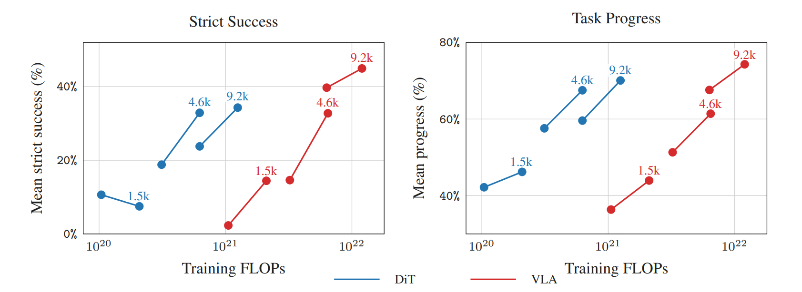
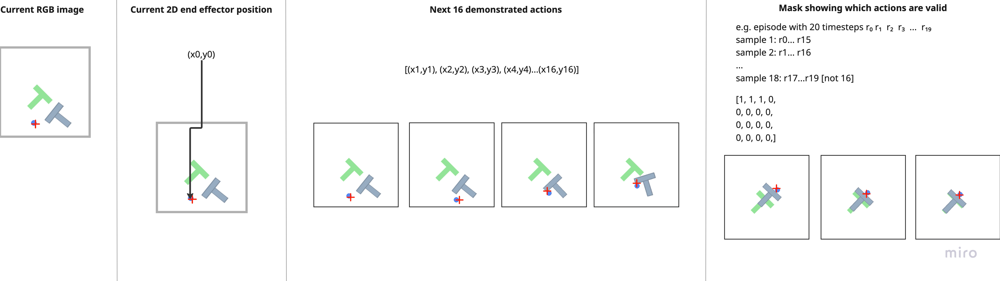
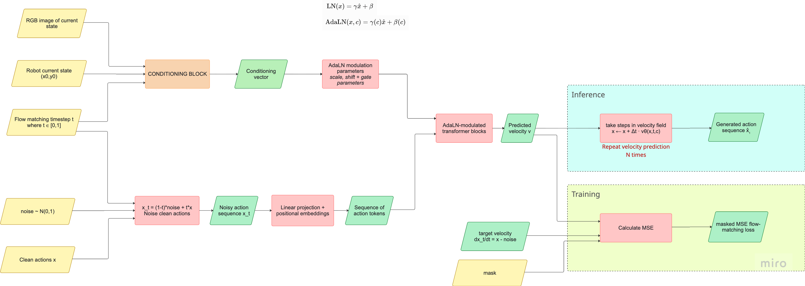
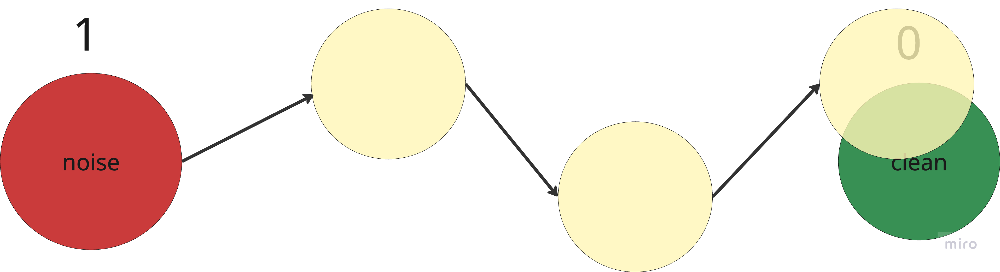
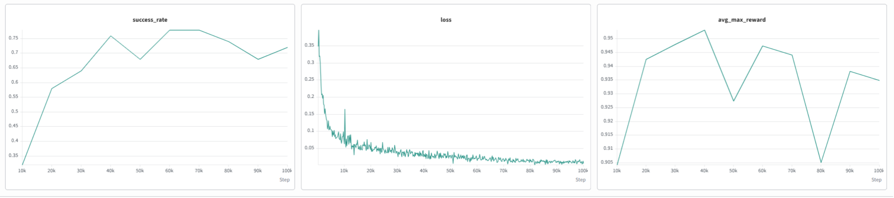
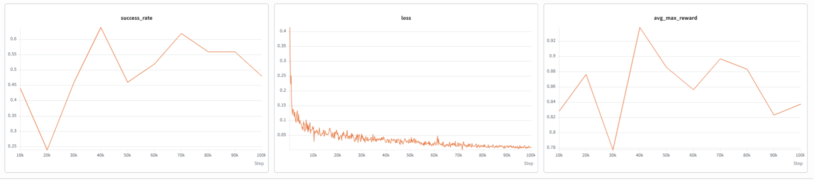
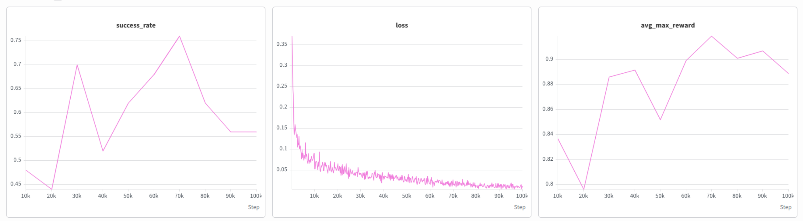
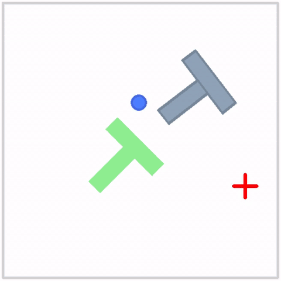
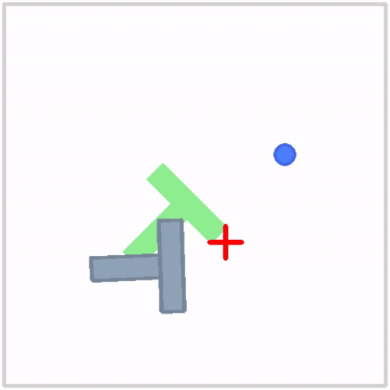
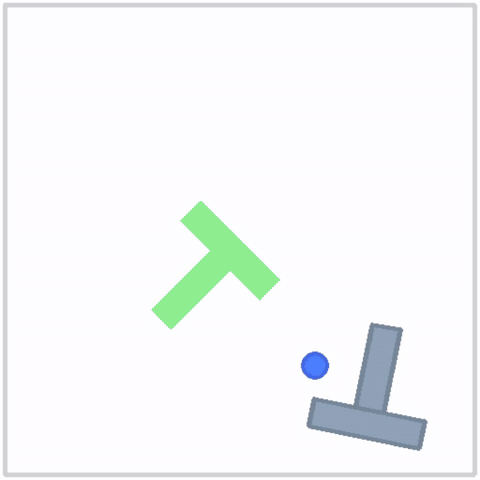

<!--
  DRAFT NOTES (delete before publishing):
  - Still missing: og_image (social preview). Search for "[PLACEHOLDER" to find it.
  - Pulled real quotes and detail from the Paper Club #6 talk transcript.
    If something sounds off or misattributed, fix it, I paraphrased rather
    than quoted verbatim in most places.
-->

**pusht-slim** is a ~600-line, single-file imitation-learning pipeline for the PushT task [[1]](https://github.com/huggingface/gym-pusht). Dataset, model, training loop, and eval, all in one file, in the spirit of nanoGPT [[2]](https://github.com/karpathy/nanoGPT). A 200M-parameter DiT [[3]](https://arxiv.org/abs/2212.09748) trained with flow matching [[4]](https://arxiv.org/abs/2210.02747) on top of DINOv2 features reaches a 0.6-0.7 success rate after 100k steps, about 3.5 hours on a single RTX 4090.

Anjana, who is new to robotics, worked through this project, and having a newcomer on it let us pick out the places where things were confusing. We call those out as we go, in the hope that they help anyone else who is new to robotics and curious.

# Why we built this

A while back Gleb sent around a video of Sunday Robotics' [[5]](https://www.sunday.ai/) ACT-2 policy instructing their Memo robot to do household chores. Sunday Robotics' has various clips of robots doing a multitude of these tasks. The specific clip sent around was of the autonomous robot folding a basket of laundry in a bedroom [link](https://www.google.com/search?q=sunday+ai+act+2+laundry&oq=sunday+ai+act+2+laundry&gs_lcrp=EgZjaHJvbWUyBggAEEUYOTIHCAEQIRigATIHCAIQIRigATIHCAMQIRigAdIBCDU2NzlqMGo0qAIAsAIB&sourceid=chrome&source=chrome.ob&ie=UTF-8#fpstate=ive&vld=cid:8d6a027b,vid:a2HZyURUE_o,st:0). This is an amazing video of the current state of robotics and one of the direcctions the space is heading in. It is also a good example of the problem we kept running into: you watch a video of, or if you are lucky enough see, a robot performing a task that is extremely hard and precise, and you learn almost nothing about how it works. Even when a lab does publish, what you get is usually a complicated multi-stage system (pretraining, mid-training, fine-tuning etc.) that is hard to grapple with because of the underlying complexity that exists within each part of the system. This makes the barrier to entry hard for people new to the space.

We wanted the opposite of that video: something small enough to understand completely. Anjana is new to robotics, and a full embodied system of hardware, software and a policy is a lot to take on at once, so we kept only the policy. Inspired by Karpathy's nanoGPT [[2]](https://github.com/karpathy/nanoGPT), we built the simplest version we could of the components that actually show up in a modern VLA-style policy, small enough to read in one sitting. That is pusht-slim.

# The paper we built on

The architecture is pulled pretty directly from the DiT policy paper [[3]](https://arxiv.org/abs/2212.09748), released in March 2023, well before VLAs took off. Physical Intelligence's π₀ [[6]](https://www.physicalintelligence.company/blog/pi0) arrived about a year and a half later, and it is the best-known example of where this recipe went next: a vision-language model bolted onto a transformer that generates actions with flow matching. The DiT policy is that action-generating half on its own, which is why it is a good starting point for a stripped-down VLA-style policy. The thing it does well is combine transformers (the same idea as the original ACT model [[7]](https://arxiv.org/abs/2304.13705)) with diffusion, which is a good way to represent the complicated, multimodal action distributions you need for precise manipulation. Its main result was that one architecture could be reused across many tasks without redesigning it each time. That is closer to the default now, and most current VLA-style policies still generate actions with a transformer and a diffusion or flow head.

However, we decided to use flow matching instead of diffusion. Apart from it being 'cooler' (Gleb Zarin 2026) it also allows for faster inference, and it is what π₀ uses.

It is a fair question whether a comparatively small architecture from 2023 is worth building around in 2026. We would say yes, and we are not alone. A recent large-scale study from UC Berkeley, Amazon FAR and collaborators [[8]](https://arxiv.org/abs/2606.27375) compares a diffusion transformer (DiT) policy against a VLA built on a Gemma 3 4B vision-language model. At smaller batch sizes and compute budgets the DiT does better, and it is more FLOP-efficient throughout. The VLA only pulls ahead in real-world performance at the largest batch sizes, which means a lot more compute. If your budget is small, because you are an independent collective and frankly a bit broke, or because you need to iterate fast on a real robot, the simpler architecture is still the right call.



*DiT vs VLA, real-world success against training FLOPs. Figure from [[8]](https://arxiv.org/abs/2606.27375) (CC BY 4.0).*

# How it works

## Task and data

PushT [[1]](https://github.com/huggingface/gym-pusht) is a 2D pushing task: push a T-shaped block onto a target pose using a circular end effector. The `lerobot/pusht` [[9]](https://huggingface.co/datasets/lerobot/pusht) hub dataset stores it compactly: one MP4 with every frame of every episode concatenated, plus a parquet file with per-frame state, action, and episode metadata. `PushTDataset` decodes the video once on startup (about 7 seconds) and keeps everything in RAM as uint8 (roughly 0.7GB), so `__getitem__` afterward is pure tensor slicing, no video decoding in the hot path.

That matters more than it sounds like. Raw video is compressed by storing a keyframe and then small deltas between frames, which is great for watching a two-hour film start to finish and terrible for a model that wants to sample random timestamps out of order. Decode once, hold it in memory, done.

Each training sample is the current RGB frame, the current 2D end-effector position, and the next 16 demonstrated actions, what people in this space call the prediction horizon. We do not execute all 16. We execute the first 8, then replan from the new observation. You might ask why we do this? Well, the longer-horizon context helps the model plan the shorter-term actions well, but the replanning every 8 steps gives it a chance to self-correct instead of committing blind to a 16-step plan.



Episodes have different lengths, so near the end of one there may be fewer than 16 actions left to predict. Lets think of an example: say an episode has 20 timesteps, r0 through r19. Sample 1 covers r0 to r15, sample 2 covers r1 to r16, and so on, fine so far. But sample 18 only has r17 to r19 left, that is only three actions instead of the sixteen the model expects. The solution to this is either to drop the samples that do not include 16 steps, this is not a great option because we lose data and the other option is that we pad the samples that are too short and mask it out, so the loss and the gradients never see the padding. 

The dataset serves raw values: `uint8` pixels and pixel-space coordinates. The model normalises them itself, inside its forward pass. That means you can feed it a frame straight out of `gym_pusht` without reimplementing a preprocessing pipeline somewhere else.

## Observation encoding

Frames are cropped to 84x84 (random crop during training, center crop at eval) and passed through a pretrained DINOv2 [[10]](https://arxiv.org/abs/2304.07193) ViT-S/14, fine-tuned end to end. 84 happens to be exactly 6x14, so the ViT sees a clean 6x6 grid of patches with no resizing.

We spent a while on how to turn those 36 patch tokens into a single conditioning vector. The DiT policy paper's own approach uses a full encoder-decoder transformer with cross-attention between image tokens and action tokens, basically a second tower. We skipped that. It is a lot of extra code for a single-task model, and the simpler route, mean-pool the patch tokens straight down to one vector and concatenate it with state and timestep, actually worked. If we ever add multiple camera views we would likely need to revisit that decision decision, however for this use case and with one 96x96 camera it was not worth the complexity.

On the random crop itself: it felt wrong to Anjana at first. Why would cropping out part of the scene help, when PushT is fully simulated and there is no real-world domain shift to guard against? Best answer we have got: even in simulation there is always some accidental structure in the data (a camera that never moves, a block that starts in a narrow range of positions) and the model will happily learn that instead of the thing you actually want it to learn. Making the input slightly harder steers it away from shortcuts. We keep the crop gentle though, 96 down to 84, so it cannot cut out anything important like the block or the target. It is also the same crop the original Diffusion Policy [[11]](https://arxiv.org/abs/2303.04137) setup uses, so keeping it means our results stay comparable to theirs. A different crop size would add another difference we would have to account for.

## Action generation: flow matching and a DiT



The policy does not predict actions directly. It predicts a velocity field that carries a sample from Gaussian noise to the 16-step action chunk, trained with flow matching [[4]](https://arxiv.org/abs/2210.02747). Picture a line between pure noise (call it position 1) and the clean, real action sequence (position 0). Given a noisy point partway along that line at some flow-time `t`, the model learns to predict the constant velocity, literally `(action - noise)`, that would carry it the rest of the way to 0.



The flow-matching timestep `t` is easy to confuse with the actual timesteps inside a PushT episode. They are unrelated. `t` just marks a position along the noise-to-clean line, nothing to do with the robot's clock.

A single scalar `t` is also a bad thing to feed a neural net directly, so we run it through sinusoidal functions at different frequencies and an MLP first, which gives every value of `t` its own distinct vector "fingerprint" instead of one number the rest of the network has to work hard to use.

A DiT [[3]](https://arxiv.org/abs/2212.09748) with adaLN conditioning (image embedding, state embedding, and timestep embedding, concatenated and projected into one vector) then processes the noisy action tokens. Instead of cross-attention between image and action tokens, the conditioning vector directly modulates the transformer's layer norms, scale, shift, and a gate, at every block.

At inference time we do not take one big jump from noise to clean actions, even though that is technically what the model was trained to approximate. We take 10 smaller steps, repredicting the velocity at each new point. The reason is the first velocity prediction is probably decent but not exact, and smaller steps let the model correct course as it gets closer, instead of committing hard to an initial estimate.

## Control and eval

Control is receding horizon, as described above: the model predicts 16 actions, we execute the first 8, then replan from the new observation. Every 10k training steps we roll the policy out in `gym-pusht` for 50 episodes and log three things to wandb: the success rate (how often the T covers more than 95% of the target within 300 steps, about 30 seconds of simulated time), the average max reward (the best score reached in each episode, averaged over episodes, where a score of 1.0 means 95% coverage), and 3 rollout videos.

A word of caution on reading those numbers. Each episode is a pass or fail, so with only 50 of them the success rate is a noisy estimate, with a standard error of roughly ±0.07. A measured 0.60 could easily be a true 0.53 or 0.67, which means a gap of a few points between two runs is mostly noise. Different training seeds add more variance on top. We could have used more episodes to evaluate on in `gym-pusht` but this would have increased our inference time. Keep in mind that the results below are these noisy estimates.

## Model scale

The DiT is sized to about 200M params (hidden dim 896, 12 layers, 8 heads). This was honestly the biggest surprise of the whole project. Gleb went in wanting to handcraft something small and clever, and we spent a while actively resisting scaling it up. At some point, mostly out of curiosity, we just tried a bigger model, and it got meaningfully better with basically no other changes. A ~47M version plateaus around 0.5 success rate. The 200M version reaches 0.6-0.7. Still a small model by any modern standard, but scale mattered more than almost anything else we tried.

# We ran this live, on stage, with audience data

At Paper Club #6 we had everyone in the room (and online) pull out their phones, play a web version of PushT, and try to align the T-block with the target as precisely and quickly as possible. Each successful attempt could be saved as a demonstration episode. We ended up with around 150 episodes in a few minutes, after a light filter for speed and minimum motion (if you sat there not moving, that episode did not count).

You can try it yourself: **[play PushT in your browser](https://robot-learning-collective.github.io/pusht-play/)**. Hold and drag the red robot to push the T-block onto the target. Try it on your phone and see how your first attempt compares.

While people asked questions, we converted the episodes into a dataset and kicked off training live. To get results quickly enough to be useful in the room, we evaluated every 2.5k steps for this run instead of the usual 10k. At the first eval, 2.5k steps in, the live model was already hitting roughly 0.54 success rate, which is, as Gleb put it at the time, probably better than an average human's first attempt at the task. By 5k steps it was around 0.8, and by 7.5k around 0.86. After that it stayed noisy in the 0.8-0.9 range, with a few later evals reaching into the 0.9s. This run used the audience-collected dataset, not the standard `lerobot/pusht` demonstrations the rest of this post is about, so do not compare those numbers directly to the ones below. But it was a fun exercise and a good demo of how little data and how little wall-clock time it takes to get a working policy out of this recipe, and it means we have 150 fairly chaotic, real PushT demonstrations that two dozen strangers generated live.


*Training curves for the live run, trained only on the audience-collected episodes.*

# Results

## Experiments

Before settling on the final configuration, we ran a lot of smaller sweeps, mostly early on and on a smaller model. Here is what we varied:

| What we varied | What we tried |
|---|---|
| Model size | ~47M, 200M, 300M |
| Generative objective | diffusion, flow matching |
| Observation history | 1 or 2 frames |
| Image features (conditioning) | mean pooling, CLS token, patch tokens, SpatialSoftmax |
| Action space | absolute, relative |
| Vision encoder | ResNet-18/34 (scratch and pretrained), DINOv2, DINOv3 |
| Optimisation | peak learning rate, learning-rate schedule, flow timestep sampling |

Most of these made little difference. With 50 eval episodes, many results sat within a few points of each other, which is inside the noise. A few things did matter. Scale was the most consistent gain, going from the small model to 200M parameters. And a few changes clearly made things worse: feeding patch tokens straight in, relative actions, a higher peak learning rate, and DINOv3.

One of these is worth a closer look, because it is where the final configuration differs most from where we started: how to turn DINOv2's patch tokens into the conditioning vector the DiT sees. We ran that as a controlled ablation, with everything else held fixed. See section below. 

## Conditioning ablation

DINOv2 hands us a 6x6 grid of 36 patch tokens, and the DiT needs a single conditioning vector built from them. We tried three ways of getting there, in this order.

**1. SpatialSoftmax** was our original recipe [[12]](https://arxiv.org/abs/1509.06113) (Finn et al., 2015): a learned 1x1 conv remaps the feature map to `num_kp` keypoint channels, softmax turns each channel into an attention map over spatial positions, and the attention-weighted mean position of each channel becomes a 2D keypoint. 32 keypoints, 64 numbers, into a linear layer. Unlike plain average pooling, it preserves where in the image features fire, not just whether they fire at all, which can matter a lot when you are only working with a 6x6 grid.



With SpatialSoftmax the config reaches a **0.6-0.7 success rate**. Two runs gave 0.72 (avg. max reward 0.93) and 0.62 (avg. max reward 0.88), which gives some sense of run-to-run variance from a single 50-episode eval.

**2. Mean pooling** asks whether SpatialSoftmax is still needed once the backbone is a pretrained DINOv2 instead of a from-scratch CNN. DINOv2's patch tokens already carry a lot of spatial and semantic structure from self-supervised pretraining, so a learned keypoint mechanism on top might be solving a problem the backbone has mostly already solved. Removing it is a nanoGPT-style simplification: delete `SpatialSoftmax` and the keypoint machinery, replace it with `tokens.mean(dim=1)`. 33 lines removed, 3 added:

```diff
-        feat_shape = (self.backbone.embed_dim, self._grid, self._grid)
-        self.pool = SpatialSoftmax(feat_shape, num_kp=num_kp)
-        self.fc = nn.Linear(num_kp * 2, out_dim)
+        self.fc = nn.Linear(self.backbone.embed_dim, out_dim)
         ...
-        b, n, c = tokens.shape
-        x = tokens.transpose(1, 2).reshape(b, c, self._grid, self._grid)
-        x = self.pool(x).flatten(1)  # (batch, num_kp * 2)
+        x = tokens.mean(dim=1)
```

This is the final configuration, and its training curves are the ones in the results above.

**3. CLS token** skips pooling altogether and uses DINOv2's own summary token as the conditioning vector.



## Comparing the three

| Conditioning | Peak success rate | Success rate at final eval | Avg. max reward at final eval |
|---|---|---|---|
| SpatialSoftmax | 0.78 (60k-70k steps) | 0.72 | 0.93 |
| Mean pooling (final configuration) | 0.76 (70k steps) | 0.56 | 0.89 |
| CLS token | 0.64 (40k steps) | 0.48 | 0.84 |

The CLS token is clearly the weakest: it is lowest on every measure and its curve is the most erratic. The other two are harder to separate. Mean pooling's final number (0.56) is well below SpatialSoftmax (0.72), but its peak (0.76) is close to SpatialSoftmax's plateau (about 0.78). The SpatialSoftmax run is noisy too, but it settles into its plateau earlier and holds it more consistently late in training, while the mean-pooling run is still swinging at the end. With 50 eval episodes, one standard error is about ±0.07, so a gap of a few points between any two of these peaks is inside the noise.

So the simplification did not necessarily result in a better or similar performing model but it is not as clear cut as "mean pooling is worse". We kept mean pooling for the same instinct behind skipping cross-attention conditioning: simpler code that still clearly works beats slightly better eval results. 


## Final Configuation Results 
The final configuration is the one on `main`: DINOv2 ViT-S/14, mean pooling, and a 200M DiT, trained for 100k steps (about 3.5 hours on an RTX 4090) on the full `lerobot/pusht` dataset. Its success rate peaked at **0.76** around 70k steps and was **0.56** at the final eval, with the average max reward finishing around 0.89.



<style>
.rollout-grid { display: flex; justify-content: center; gap: 1.5rem; flex-wrap: wrap; margin: 2rem 0; }
.rollout-grid img { width: 260px; height: 260px; border-radius: 8px; border: 1px solid #ddd; }
</style>

<div class="rollout-grid">
  
  
  
</div>

*Three rollout episodes from the final configuration's eval.*

That final number is more fragile than it looks. The success rate does not sit at 0.56 for most of training: it swings between roughly 0.45 and 0.76 from eval to eval, and the last eval happens to land on a low point. A single 50-episode eval at a single checkpoint is a noisy way to measure that, so it is worth reading the whole curve and not just the last point.

One thing that confused Anjana, and might confuse you: look at how the loss and the success rate in that chart relate. The loss falls fast in the first 10-20k steps and then keeps creeping down all the way to 100k, but the success rate does not follow it. It peaks around 70k steps, then drifts back down. A lower loss does not guarantee a better policy.

Our best understanding of why: the loss measures how well the model predicts the demonstrated actions, one chunk at a time, on the training data. Success is a different test. The policy has to run in a closed loop, where its own small errors compound and a single bad push can leave the block somewhere the demonstrations never went. So the loss can keep improving while the behaviour does not. It is also why we evaluate by actually rolling the policy out, as described in the eval section, rather than trusting the loss curve.

# What is next

The mean-pooling encoder is what `main` is built on now, and it is currently branching into a few directions:
- **Conditioning**: does cross-attention between action tokens and image patches beat concatenation-based adaLN conditioning?
- **Backbone**: how does DINOv2 compare against a scaled ResNet-34 baseline?
- **Beyond PushT**: a Rapier2D-based "PushT-mobile" environment, to see whether the recipe holds up past the original fixed-base task.

We will keep posting results here as the log grows. Keeping pusht-slim small is what makes that possible: each of these stays a diff against one file, not a rewrite.

# Try it yourself

```bash
git clone https://github.com/Robot-Learning-Collective/pusht-slim.git
cd pusht-slim
pip install -r requirements.txt
export WANDB_API_KEY=...   # metrics and eval videos go to wandb
python train.py
```

All hyperparameters live as constants at the top of `train.py`. Set `WANDB_ENTITY`/`WANDB_PROJECT` to your own account and go. Checkpoints land in `checkpoints_<run-name>/`. For a cloud GPU box, see the repo's [RunPod setup notes](https://github.com/Robot-Learning-Collective/pusht-slim/blob/main/runpod_setup.md).

# Conclusion

That is the point of keeping this small. Removing SpatialSoftmax was a 30-line diff, trainable in an afternoon, directly comparable against the previous version with nothing else changing, and because we could pull up the full training curve instead of just the final number, we caught that the gap is mostly about training stability near the end of the run, not a hard capability difference. That is exactly the kind of thing that is easy to miss in a bigger codebase and easy to catch in a 600-line one, as long as you actually go look at the curve and not just the summary stat. The next experiments, like cross-attention conditioning, will follow the same format: a diff, a number, a curve, and whatever we actually learned from it.

# Team

<style>
.team-grid { display: flex; justify-content: center; gap: 3rem; flex-wrap: wrap; margin: 2rem 0; }
.team-member { text-align: center; }
.team-member img { width: 140px; height: 140px; border-radius: 50%; object-fit: cover; border: 3px solid #ddd; transition: transform 0.2s; }
.team-member img:hover { transform: scale(1.05); }
.team-member p { margin-top: 0.75rem; font-weight: 500; color: #333; }
</style>

<div class="team-grid">
  <div class="team-member">
    
    <p><a href="https://www.linkedin.com/in/anjana-yodaiken/">Anjana Yodaiken</a></p>
  </div>
  <div class="team-member">
    
    <p><a href="https://www.linkedin.com/in/zaringleb/">Gleb Zarin</a></p>
  </div>
</div>

# References

[1] Hugging Face, "gym-pusht," GitHub repository. [Online]. Available: [https://github.com/huggingface/gym-pusht](https://github.com/huggingface/gym-pusht)

[2] A. Karpathy, "nanoGPT," GitHub repository, 2022. [Online]. Available: [https://github.com/karpathy/nanoGPT](https://github.com/karpathy/nanoGPT)

[3] W. Peebles and S. Xie, "Scalable diffusion models with transformers," arXiv:2212.09748, 2022.

[4] Y. Lipman, R. T. Q. Chen, H. Ben-Hamu, M. Nickel, and M. Le, "Flow matching for generative modeling," arXiv:2210.02747, 2022.

[5] Sunday Robotics. [Online]. Available: [https://www.sundayrobotics.ai/](https://www.sundayrobotics.ai/)

[6] Physical Intelligence, "π₀: Our first generalist policy," Physical Intelligence Blog, 2024. [Online]. Available: [https://www.physicalintelligence.company/blog/pi0](https://www.physicalintelligence.company/blog/pi0)

[7] T. Z. Zhao, V. Kumar, S. Levine, and C. Finn, "Learning fine-grained bimanual manipulation with low-cost hardware," arXiv:2304.13705, 2023.

[8] A. Allshire et al., "Scalable behavior cloning with open data, training, and evaluation," arXiv:2606.27375, 2026.

[9] Hugging Face, "lerobot/pusht," Hugging Face Datasets. [Online]. Available: [https://huggingface.co/datasets/lerobot/pusht](https://huggingface.co/datasets/lerobot/pusht)

[10] M. Oquab et al., "DINOv2: Learning robust visual features without supervision," arXiv:2304.07193, 2023.

[11] C. Chi, S. Feng, Y. Du, Z. Xu, E. Cousineau, B. Burchfiel, and S. Song, "Diffusion policy: Visuomotor policy learning via action diffusion," arXiv:2303.04137, 2023.

[12] C. Finn, X. Y. Tan, Y. Duan, T. Darrell, S. Levine, and P. Abbeel, "Deep spatial autoencoders for visuomotor learning," arXiv:1509.06113, 2015.
