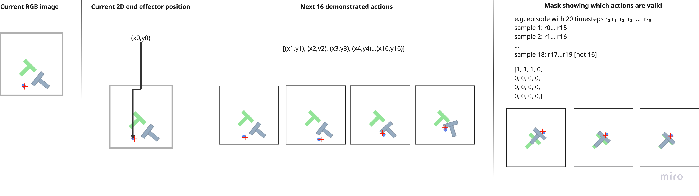
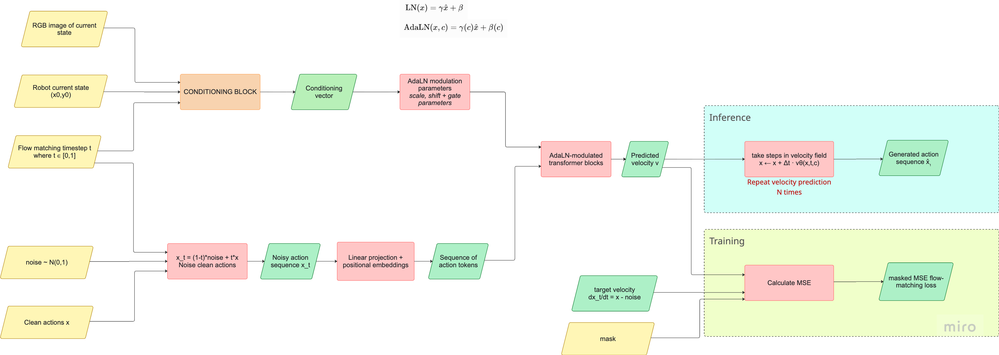
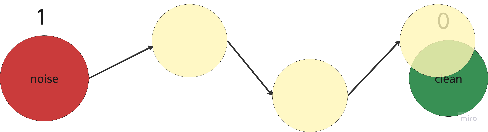
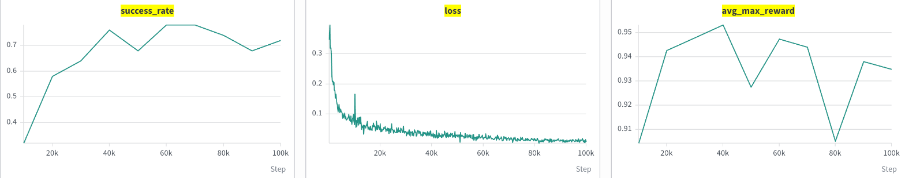
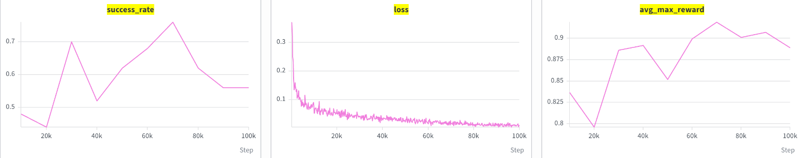

<!--
  DRAFT NOTES (delete before publishing):
  - Still missing: og_image (social preview). Search for "[PLACEHOLDER" to find it.
  - Pulled real quotes and detail from the Paper Club #6 talk transcript.
    If something sounds off or misattributed, fix it, I paraphrased rather
    than quoted verbatim in most places.
-->

**pusht-slim** is a ~600-line, single-file imitation-learning pipeline for the PushT task [[1]](https://github.com/huggingface/gym-pusht). Dataset, model, training loop, and eval, all in one file, in the spirit of nanoGPT [[2]](https://github.com/karpathy/nanoGPT). A 200M-parameter DiT [[3]](https://arxiv.org/abs/2212.09748) trained with flow matching [[4]](https://arxiv.org/abs/2210.02747) on top of DINOv2 features reaches a 0.6-0.7 success rate after 100k steps, about 3.5 hours on a single RTX 4090.

# Why we built this

A while back Gleb sent around a video of Sunday Robotics' ACT-2 [[5]](https://www.sundayrobotics.ai/) folding a basket of laundry, fully autonomous, in someone's actual bedroom. Genuinely great clip, still one of our favorites. It's also a pretty good example of a problem we kept running into: you watch a robot do something hard and precise, and you learn almost nothing about how it works. Even when a lab does publish, what you get is usually a complicated multi-stage system (pretraining, mid-training, fine-tuning, who knows what else) and it's hard to tell which part is actually carrying the result.

So we went the other way. Inspired by Karpathy's nanoGPT [[2]](https://github.com/karpathy/nanoGPT), we tried to build the simplest version we could of the components that actually show up in a modern VLA-style policy. Not a toy, a real working system, just stripped down to the point where you can read the whole thing in one sitting. That's pusht-slim.

Anjana was new to robot learning when this started. Gleb had a whole list of possible projects, some of them fairly involved embodied AI builds with real hardware. Simple won, partly because it meant there'd be something to actually build on instead of fighting hardware on day one.

# The paper we built on

The architecture is pulled pretty directly from the DiT policy paper [[3]](https://arxiv.org/abs/2212.09748), released about two years ago by folks who, in some cases, went on to co-found Physical Intelligence. It landed around the same time as their original π₀ blog post [[6]](https://www.physicalintelligence.company/blog/pi0), which makes it, in a sense, the best model of the pre-VLA era. The thing it does well is combine transformers (the same idea as the original ACT model [[7]](https://arxiv.org/abs/2304.13705)) with diffusion, which is a genuinely good way to represent the complicated, multimodal action distributions you need for precise manipulation. Back then, not needing to redesign the architecture for every new task was a real result. It's closer to table stakes now, but the recipe underneath still holds up.

The one deliberate swap we made is flow matching instead of diffusion. Faster inference, and it's what π₀ itself uses, so there was already a direction to copy.

It's a fair question whether a two-year-old, comparatively tiny architecture is worth building around in 2026. We'd say yes, and we're not alone: a more recent scaling study from X-Square and Amazon [8]<!-- TODO: link the actual paper, don't have a confirmed citation for this one --> directly compares ACT-style policies against VLAs at matched training budgets, and ACT keeps up right up until you're willing to spend a lot of compute. If your budget is small, because you're an independent collective and frankly a bit broke, or because you need to iterate fast on a real robot, the simple architecture is still the right call.

# How it works

## Task and data

PushT [[1]](https://github.com/huggingface/gym-pusht) is a 2D pushing task: push a T-shaped block onto a target pose using a circular end effector. The `lerobot/pusht` [[9]](https://huggingface.co/datasets/lerobot/pusht) hub dataset stores it compactly: one MP4 with every frame of every episode concatenated, plus a parquet file with per-frame state, action, and episode metadata. `PushTDataset` decodes the video once on startup (about 7 seconds) and keeps everything in RAM as uint8 (roughly 0.7GB), so `__getitem__` afterward is pure tensor slicing, no video decoding in the hot path.

That matters more than it sounds like. Raw video is compressed by storing a keyframe and then small deltas between frames, which is great for watching a two-hour film start to finish and terrible for a model that wants to sample random timestamps out of order. Decode once, hold it in memory, done.

Each training sample is the current RGB frame, the current 2D end-effector position, and the next 16 demonstrated actions, what people in this space call the prediction horizon. We don't execute all 16. We execute the first 8, then replan from the new observation. That gap matters: longer-horizon context helps the model plan the shorter-term actions well, but only replanning every 8 steps gives it a chance to self-correct instead of committing blind to a 16-step plan.



Episodes have different lengths, so near the end of one there may be fewer than 16 real actions left to predict. Concretely: say an episode has 20 timesteps, r0 through r19. Sample 1 covers r0 to r15, sample 2 covers r1 to r16, and so on, fine so far. But sample 18 only has r17 to r19 left, three real actions instead of sixteen. We pad the rest and mask it out, so the loss and the gradients never see the padding. Simple, but easy to get subtly wrong if you're not careful about it.

Data is served raw: uint8 pixels, pixel-space coordinates. All normalization lives inside the model, not the dataset, so you can feed it a frame straight out of `gym_pusht` without reimplementing a preprocessing pipeline somewhere else.

## Observation encoding

Frames are cropped to 84x84 (random crop during training, center crop at eval) and passed through a pretrained DINOv2 [[10]](https://arxiv.org/abs/2304.07193) ViT-S/14, fine-tuned end to end. 84 happens to be exactly 6x14, so the ViT sees a clean 6x6 grid of patches with no resizing.

We spent a while on how to turn those 36 patch tokens into a single conditioning vector. The DiT policy paper's own approach uses a full encoder-decoder transformer with cross-attention between image tokens and action tokens, basically a second tower. We skipped that. It's a lot of extra code for a single-task model, and the simpler route, mean-pool the patch tokens straight down to one vector and concatenate it with state and timestep, actually worked. If we ever add multiple camera views that decision probably gets revisited, but for one 96x96 camera it wasn't worth the complexity.

On the random crop itself: it felt wrong to Anjana at first. Why would cropping out part of the scene help, when PushT is fully simulated and there's no real-world domain shift to guard against? Best answer we've got: even in simulation there's always some accidental structure in the data (a camera that never moves, a block that starts in a narrow range of positions) and the model will happily learn that instead of the thing you actually want it to learn. Making the input slightly harder steers it away from shortcuts. We keep the crop gentle though, 96 down to 84, and we don't rotate, mostly so we're staying comparable to the original diffusion policy [[11]](https://arxiv.org/abs/2303.04137) setup rather than introducing a variable we can't control for.

## Action generation: flow matching and a DiT



The policy doesn't predict actions directly. It predicts a velocity field that carries a sample from Gaussian noise to the 16-step action chunk, trained with flow matching [[4]](https://arxiv.org/abs/2210.02747). Picture a line between pure noise (call it position 1) and the clean, real action sequence (position 0). Given a noisy point partway along that line at some flow-time `t`, the model learns to predict the constant velocity, literally `(action - noise)`, that would carry it the rest of the way to 0.



The flow-matching timestep `t` is easy to confuse with the actual timesteps inside a PushT episode. They're unrelated. `t` just marks a position along the noise-to-clean line, nothing to do with the robot's clock.

A single scalar `t` is also a bad thing to feed a neural net directly, so we run it through sinusoidal functions at different frequencies and an MLP first, which gives every value of `t` its own distinct vector "fingerprint" instead of one number the rest of the network has to work hard to use.

A DiT [[3]](https://arxiv.org/abs/2212.09748) with adaLN conditioning (image embedding, state embedding, and timestep embedding, concatenated and projected into one vector) then processes the noisy action tokens. Instead of cross-attention between image and action tokens, the conditioning vector directly modulates the transformer's layer norms, scale, shift, and a gate, at every block.

At inference time we don't take one big jump from noise to clean actions, even though that's technically what the model was trained to approximate. We take 10 smaller steps, repredicting the velocity at each new point. The reason is almost exactly why you wouldn't bet everything on your first guess: the first velocity prediction is probably decent but not exact, and smaller steps let the model correct course as it gets closer, instead of committing hard to an initial estimate.

## Control and eval

Control is receding horizon, as mentioned above: predict 16, execute 8, replan. Every 10k training steps the policy is rolled out in `gym-pusht` for 50 episodes (enough to bring success-rate noise down to roughly ±0.07); success rate, average max reward, and 3 rollout videos get logged to wandb.

## Model scale

The DiT is sized to about 200M params (hidden dim 896, 12 layers, 8 heads). This was honestly the biggest surprise of the whole project. Gleb went in wanting to handcraft something small and clever, and spent a while actively resisting scaling it up. At some point, mostly out of curiosity, we just tried a bigger model, and it got meaningfully better with basically no other changes. A ~47M version plateaus around 0.5 success rate. The 200M version reaches 0.6-0.7. Still a small model by any modern standard, but scale mattered more than almost anything else we tried.

# We ran this live, on stage, with audience data

At Paper Club #6 we didn't just present slides. We had everyone in the room (and online) pull out their phones, play a web version of PushT, and try to align the T-block with the target as precisely and quickly as possible. Each successful attempt could be saved as a demonstration episode. We ended up with around 150 episodes in a few minutes, after a light filter for speed and minimum motion (if you sat there not moving, that episode didn't count).

While people asked questions, we converted the episodes into a dataset and kicked off training live. At 5k steps, about ten minutes in, the live model was already hitting roughly 0.54 success rate, which is, as Gleb put it at the time, probably better than an average human's first attempt at the task. By around 10-12k steps it was up around 0.86. That run used its own small, audience-collected dataset, not the standard `lerobot/pusht` demonstrations the rest of this post is about, so don't compare that 0.86 directly to the numbers below. But it's a genuinely good demo of how little data and how little wall-clock time it takes to get a working policy out of this recipe, and it means we have 150 fairly chaotic, real PushT demonstrations that two dozen strangers generated live and can genuinely say we collected them together.

# Baseline results

Trained for 100k steps (about 3.5 hours on an RTX 4090) on the full `lerobot/pusht` dataset, the baseline recipe (DINOv2 + SpatialSoftmax pooling) reaches a **0.6-0.7 success rate**. Two from-scratch runs on the same config: 0.72 SR (avg. max reward 0.93) and 0.62 SR (avg. max reward 0.88), which gives some sense of run-to-run variance from a single 50-episode eval.



<style>
.rollout-grid { display: flex; justify-content: center; gap: 1.5rem; flex-wrap: wrap; margin: 2rem 0; }
.rollout-grid video { width: 260px; height: 260px; border-radius: 8px; border: 1px solid #ddd; }
</style>

<div class="rollout-grid">
  <video src="assets/pusht-slim/eval-rollout-1.mp4" autoplay loop muted playsinline controls></video>
  <video src="assets/pusht-slim/eval-rollout-2.mp4" autoplay loop muted playsinline controls></video>
  <video src="assets/pusht-slim/eval-rollout-3.mp4" autoplay loop muted playsinline controls></video>
</div>

*Three rollout episodes from the baseline eval, straight from wandb.*

# Ablation: do we need SpatialSoftmax?

The original `ImageEncoder` pooled DINOv2's 6x6 patch grid with SpatialSoftmax [[12]](https://arxiv.org/abs/1509.06113) (Finn et al., 2015): a learned 1x1 conv remaps the feature map to `num_kp` keypoint channels, softmax turns each channel into an attention map over spatial positions, and the attention-weighted mean position of each channel becomes a 2D keypoint. 32 keypoints, 64 numbers, into a linear layer. Unlike plain average pooling, it preserves where in the image features fire, not just whether they fire at all, which can matter a lot when you're only working with a 6x6 grid.

`exp1` asked whether that's still true once the backbone is a pretrained DINOv2 instead of a from-scratch CNN. DINOv2's patch tokens already carry a lot of spatial and semantic structure from self-supervised pretraining, so a learned keypoint mechanism on top might be solving a problem the backbone has mostly already solved. The change itself is a genuine nanoGPT-style simplification: delete `SpatialSoftmax` and the keypoint machinery, replace it with `tokens.mean(dim=1)`. 33 lines removed, 3 added:

```diff
-        feat_shape = (self.backbone.embed_dim, self._grid, self._grid)
-        self.pool = SpatialSoftmax(feat_shape, num_kp=num_kp)
-        self.fc = nn.Linear(num_kp * 2, out_dim)
+        self.fc = nn.Linear(self.backbone.embed_dim, out_dim)
         ...
-        b, n, c = tokens.shape
-        x = tokens.transpose(1, 2).reshape(b, c, self._grid, self._grid)
-        x = self.pool(x).flatten(1)  # (batch, num_kp * 2)
+        x = tokens.mean(dim=1)
```

**Result:** mean pooling comes in at **0.56 success rate** (avg. max reward 0.89), below both SpatialSoftmax runs (0.72 and 0.62).



That final number is a bit more fragile than it looks, though. Looking at the actual curve, `exp1`'s success rate doesn't sit at 0.56 for most of training, it's noisy the whole way through, dips hard in the 20k-40k range, and actually peaks around 0.78 near step 70k, close to the SpatialSoftmax baseline's own plateau, before dropping back down to 0.56 by the step we happened to run the final eval at. The SpatialSoftmax run is noisy too, but settles into its plateau earlier and holds it more consistently late in training.

So the simplification wasn't free, but it's murkier than "mean pooling is worse." Both configs reach roughly the same peak capability; the gap in the final reported numbers owes a lot to how unstable `exp1` still is late in training, and a single 50-episode eval at a single checkpoint is not a great way to measure that. We don't have a clean, run-matched explanation for why `main` went ahead and adopted mean pooling anyway (`refactor: remove spatial softmax #16`), with `exp2` and `exp3` building on top of it rather than reverting. The honest answer is probably the same instinct behind skipping cross-attention conditioning in the first place: simpler code that still clearly works, most of the time, beats a few more points on one eval. Whether that instinct holds up here specifically is still an open question, and the real fix isn't more reading of this chart, it's more seeds, and probably evaluating the best checkpoint in a window rather than just the last one.

# What's next

The mean-pooling encoder from `exp1` is the baseline `main` is built on now, and it's currently branching into a few directions:
- **Conditioning**: does a CLS-token summary or cross-attention between action tokens and image patches beat concatenation-based adaLN conditioning?
- **Backbone**: how does DINOv2 compare against a scaled ResNet-34 baseline?
- **Beyond PushT**: a Rapier2D-based "PushT-mobile" environment, to see whether the recipe holds up past the original fixed-base task.

We'll keep posting results here as the log grows. Keeping pusht-slim small is what makes that possible: each of these stays a diff against one file, not a rewrite.

# Try it yourself

```bash
git clone https://github.com/Robot-Learning-Collective/pusht-slim.git
cd pusht-slim
pip install -r requirements.txt
export WANDB_API_KEY=...   # metrics and eval videos go to wandb
python train.py
```

All hyperparameters live as constants at the top of `train.py`. Set `WANDB_ENTITY`/`WANDB_PROJECT` to your own account and go. Checkpoints land in `checkpoints_<run-name>/`. For a cloud GPU box, see the repo's [RunPod setup notes](https://github.com/Robot-Learning-Collective/pusht-slim/blob/main/runpod_setup.md).

# Conclusion

That's the point of keeping this small. `exp1` is a 30-line diff, trainable in an afternoon, directly comparable against the baseline with nothing else changing, and because we could pull up the full training curve instead of just the final number, we caught that the gap is mostly about training stability near the end of the run, not a hard capability difference. That's exactly the kind of thing that's easy to miss in a bigger codebase and easy to catch in a 600-line one, as long as you actually go look at the curve and not just the summary stat. `exp2` (CLS-token conditioning) and `exp3` (cross-attention) are next, same format: a diff, a number, a curve, and whatever we actually learned from it.

# Team

<style>
.team-grid { display: flex; justify-content: center; gap: 3rem; flex-wrap: wrap; margin: 2rem 0; }
.team-member { text-align: center; }
.team-member img { width: 140px; height: 140px; border-radius: 50%; object-fit: cover; border: 3px solid #ddd; transition: transform 0.2s; }
.team-member img:hover { transform: scale(1.05); }
.team-member p { margin-top: 0.75rem; font-weight: 500; color: #333; }
</style>

<div class="team-grid">
  <div class="team-member">
    
    <p><a href="https://www.linkedin.com/in/zaringleb/">Gleb Zarin</a></p>
  </div>
  <div class="team-member">
    
    <p><a href="https://www.linkedin.com/in/anjana-yodaiken/">Anjana Yodaiken</a></p>
  </div>
</div>

# References

[1] Hugging Face, "gym-pusht," GitHub repository. [Online]. Available: [https://github.com/huggingface/gym-pusht](https://github.com/huggingface/gym-pusht)

[2] A. Karpathy, "nanoGPT," GitHub repository, 2022. [Online]. Available: [https://github.com/karpathy/nanoGPT](https://github.com/karpathy/nanoGPT)

[3] W. Peebles and S. Xie, "Scalable diffusion models with transformers," arXiv:2212.09748, 2022.

[4] Y. Lipman, R. T. Q. Chen, H. Ben-Hamu, M. Nickel, and M. Le, "Flow matching for generative modeling," arXiv:2210.02747, 2022.

[5] Sunday Robotics. [Online]. Available: [https://www.sundayrobotics.ai/](https://www.sundayrobotics.ai/)

[6] Physical Intelligence, "π₀: Our first generalist policy," Physical Intelligence Blog, 2024. [Online]. Available: [https://www.physicalintelligence.company/blog/pi0](https://www.physicalintelligence.company/blog/pi0)

[7] T. Z. Zhao, V. Kumar, S. Levine, and C. Finn, "Learning fine-grained bimanual manipulation with low-cost hardware," arXiv:2304.13705, 2023.

[8] X-Square and Amazon, scaling comparison of ACT-style policies vs. VLAs at matched training budgets. *Citation pending, we don't have a confirmed arXiv link for this one yet.*

[9] Hugging Face, "lerobot/pusht," Hugging Face Datasets. [Online]. Available: [https://huggingface.co/datasets/lerobot/pusht](https://huggingface.co/datasets/lerobot/pusht)

[10] M. Oquab et al., "DINOv2: Learning robust visual features without supervision," arXiv:2304.07193, 2023.

[11] C. Chi, S. Feng, Y. Du, Z. Xu, E. Cousineau, B. Burchfiel, and S. Song, "Diffusion policy: Visuomotor policy learning via action diffusion," arXiv:2303.04137, 2023.

[12] C. Finn, X. Y. Tan, Y. Duan, T. Darrell, S. Levine, and P. Abbeel, "Deep spatial autoencoders for visuomotor learning," arXiv:1509.06113, 2015.
